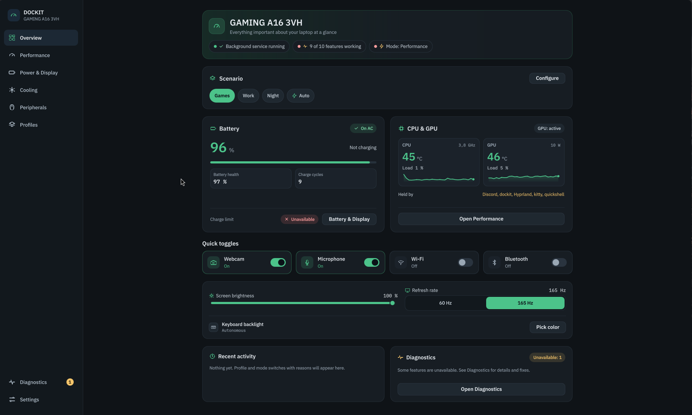
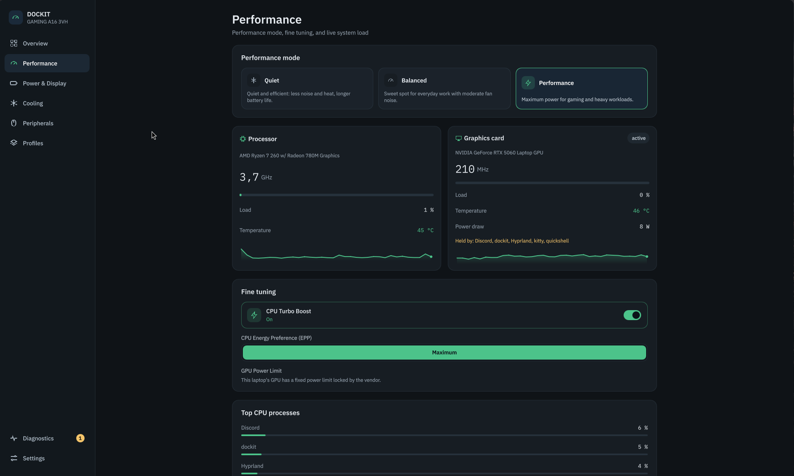
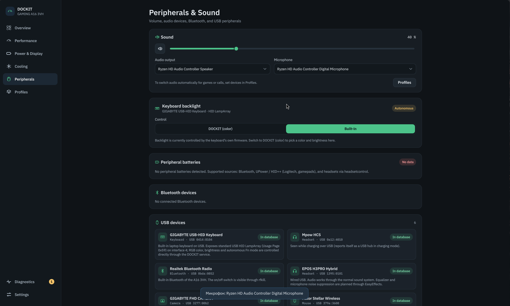
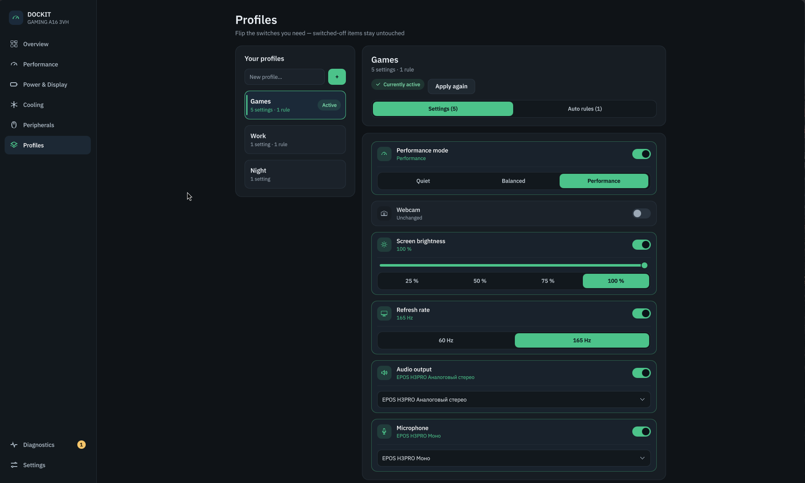

<div align="center">


# DOCKIT

**Device and Operational Control Kit for Integrated Tuning**

An open-source Linux laptop control panel — a clean, lightweight alternative to Windows-only vendor suites like **Gigabyte GiMATE**, **Lenovo Vantage**, **MSI Center**, and others.

[](https://github.com/aktirf/dockit-panel/releases)
[](https://www.python.org/)
[](LICENSE)
[](#features)
[](https://github.com/aktirf/dockit-panel/actions/workflows/tests.yml)

**English** · [Русский](README.ru.md)

<br />



</div>

---

> **Status:** active beta (`0.14.3`), daily-driven on **Gigabyte Gaming A16 3VH** (Ryzen 7 260, RTX 5060) on CachyOS (Hyprland & KDE Plasma).
> Unofficial open-source project — not affiliated with Gigabyte, Lenovo, MSI, EPOS, Hator, or any other manufacturer.

## Screenshots

| Performance & NVIDIA Sleep Guard | Peripherals, Sound & RGB Backlight |
| :---: | :---: |
|  |  |
| **Profiles & Automatic Rules** | **Overview (shown above)** |
|  | Live telemetry, quick toggles, brightness, refresh rate, keyboard RGB shortcut, and activity journal. |

## Features

- **Honest hardware detection & onboarding wizard** — scans your laptop/PC read-only on first launch and shows what works out of the box, what needs setup, and what is unsupported (no guessing, no silent stubs).
- **Performance, AMD & NVIDIA GPU support** — platform performance modes (`Quiet`, `Balanced`, `Dynamic` on AMD `amd-pstate-epp`, `Performance`), CPU Turbo Boost & EPP, GPU power limit, **AMD Radeon** `amdgpu` telemetry, and **NVIDIA D3 sleep tracking** that never wakes a sleeping GPU with `nvidia-smi` and lists which apps keep it awake.
- **Universal laptop controls** — automatic USB UVC webcam toggle (works on any laptop without a model entry) and universal battery charge limit (`charge_control_end_threshold` + Lenovo `conservation_mode`).
- **Keyboard RGB backlight** — native **USB HID LampArray** (Usage Page `0x59`, works out of the box on Gigabyte Gaming A16 `0414:8104` and Windows Dynamic Lighting keyboards with sRGB gamma correction) plus standard `/sys/class/leds/*kbd_backlight*` fallback.
- **Profiles & automatic rules** — bundle performance mode, refresh rate, screen brightness, webcam, and PipeWire audio devices into profiles (`Games`, `Work`, `Night`, or custom) and auto-switch by running apps/games, AC/battery, idle time, temperature, or time of day.
- **Peripherals & batteries** — PipeWire volume slider & output/mic switcher, Bluetooth devices, wireless peripheral battery monitoring (`UPower`, `/sys/class/power_supply` HID++, Bluetooth, optional `headsetcontrol`), and a plain-text hardware database (`devices/`).
- **Safe root daemon (`polkit`)** — reading needs no setup; every system change goes through a minimal Unix-socket service that allows only fixed validated actions and checks the caller's real PID via `polkit`.
- **Multilingual & tiling-friendly** — instant live switching between **English**, **Русский**, and **Українська**, adaptive icon-rail sidebar for narrow tiled windows, 5 accent colors, cursor-anchored tooltips, and a system tray menu.

## Quick Install (Arch / CachyOS / EndeavourOS)

```bash
git clone https://github.com/aktirf/dockit-panel
cd dockit-panel
scripts/install.sh
```

This installs required dependencies, sets up the root `dockit.service` in `/opt/dockit`, installs polkit rules, and adds **DOCKIT** to your application menu. To uninstall cleanly:

```bash
sudo scripts/uninstall-dev.sh
```

### Try read-only (no root, changes nothing)

```bash
git clone https://github.com/aktirf/dockit-panel
cd dockit-panel
python -m venv --system-site-packages .venv
source .venv/bin/activate
pip install -e .
dockit scan              # check what works on your laptop
dockit report --lang en  # generate a clean report for GitHub Issues
dockit gui               # open the control panel (view-only without the service)
```

## CLI Commands

| Command | Description |
|---|---|
| `dockit gui` | Open the Qt Quick control panel (single-instance) |
| `dockit scan [--json]` | Read-only hardware & feature scan |
| `dockit report [--markdown] [--lang auto\|en\|ru\|uk]` | Plain-text or Markdown report for GitHub Issues (no serial numbers or hostnames) |
| `dockit mode [games\|work\|night\|next]` | List profiles, apply one, or cycle (`next` is great for a hotkey) |
| `dockit auto` | Run automatic profile switching in the background |
| `dockit profile [low-power\|balanced\|dynamic\|performance]` | Show or switch ACPI platform profile / AMD dynamic mode |
| `dockit battery-limit [status\|60..100\|on\|off]` | Show or set battery charge threshold / Lenovo conservation mode |
| `dockit backlight [status\|on\|off\|auto] [--color #RRGGBB] [--brightness 0..100]` | Control keyboard RGB / LED backlight |
| `dockit restore` | Quietly restore saved refresh rate, power mode, and keyboard RGB on login |
| `dockit gpu` | Check whether the NVIDIA GPU is asleep and which apps hold it awake |
| `dockit camera status\|on\|off` | Toggle the built-in USB webcam |
| `dockit audio [status\|output\|input\|mic\|volume]` | Control PipeWire audio devices and volume |

Custom profiles and rules are stored in `~/.config/dockit/profiles.toml`:

```toml
[profiles.games]
power = "performance"
camera = false
refresh = 165

[[rules]]
profile = "games"
processes = ["steam_app_*", "cs2"]

[[rules]]
profile = "night"
when = "battery"
```

## Desktops & Window Managers

Most of DOCKIT talks directly to the Linux kernel, PipeWire, BlueZ, and `systemd-logind`, so it works across desktops. Desktop-specific features:

| Desktop / WM | Screen refresh rate | Idle rule (AFK) | Autostart |
|---|---|---|---|
| **Hyprland** (0.55+ Lua & `.conf`) | `hyprctl eval` / `keyword` | `swayidle` | `exec-once = dockit gui` |
| **KDE Plasma (Wayland)** | `kscreen-doctor` | `swayidle` | automatic (`~/.config/autostart`) |
| **niri** | `niri msg` | `swayidle` | `spawn-at-startup "dockit" "gui"` |
| **Sway / wlroots** | `swaymsg` | `swayidle` | `exec dockit gui` |
| **X11 (i3, XFCE, etc.)** | `xrandr` | — | `exec --no-startup-id dockit gui` |
| **GNOME** | partial | — | automatic (`~/.config/autostart`) |

## Security & Architecture

- **Zero-dependency core** (`src/dockit/core/`): pure Python 3.11+ logic, no Qt imports, unit-tested without real hardware (`pytest`).
- **Strict root daemon** (`src/dockit/daemon/`): accepts only allowlisted actions (`set_power_profile`, `set_camera`, `set_brightness`, `set_boost`, `set_epp`, `set_gpu_power_limit`, `set_kbd_backlight`, `set_battery_limit`), validates every argument, never accepts file paths from clients, and checks real peer credentials (`SO_PEERCRED`) against `polkit`.
- **Plain-text device database** (`devices/`): one small TOML file per laptop or USB peripheral — easy to extend.

## Help Support More Laptops

Want DOCKIT to recognize your laptop or peripherals? Run:

```bash
dockit report --lang en
```

and open a GitHub Issue using the **Device report** template (reports never include serial numbers, usernames, or hostnames).

## License

GPL-3.0-or-later. See [LICENSE](LICENSE).
