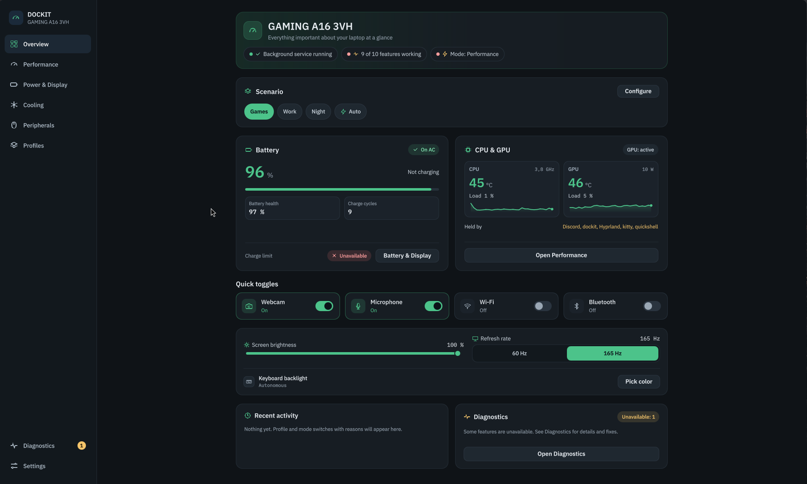
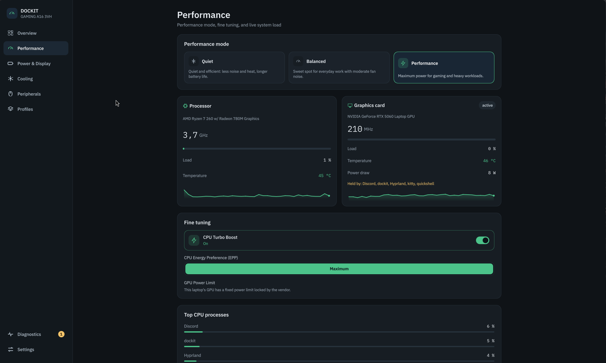
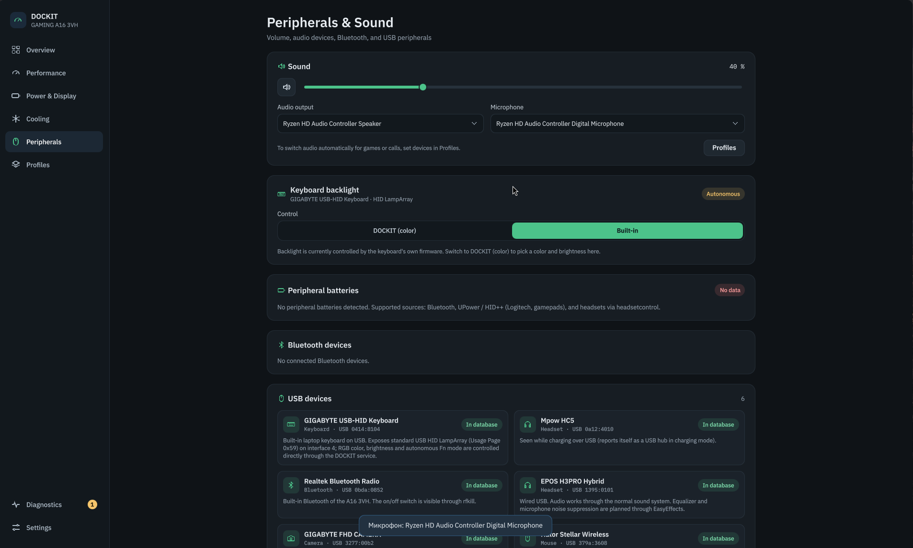
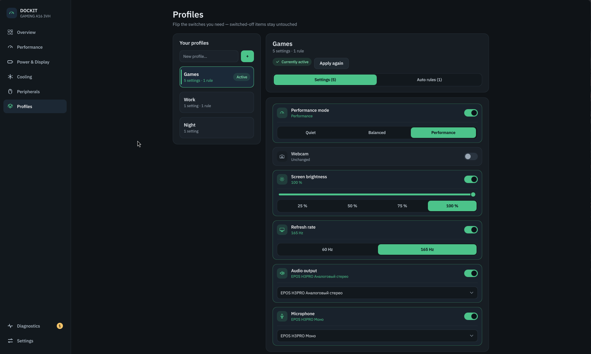

<div align="center">


# DOCKIT

**Device and Operational Control Kit for Integrated Tuning**

Открытая панель управления для ноутбуков на Linux — честная и понятная замена фирменным Windows-программам вроде Gigabyte GiMATE.

[](https://github.com/aktirf/dockit-panel)
[](https://www.python.org/)
[](LICENSE)
[](#возможности)
[](https://github.com/aktirf/dockit-panel/actions/workflows/tests.yml)

[English](README.md) · **Русский**

<br />



</div>

---

> **Статус:** активная бета (`0.10.1`), ежедневно тестируется на **Gigabyte Gaming A16 3VH** (Ryzen 7 260, RTX 5060) под CachyOS (Hyprland и KDE Plasma).
> Неофициальный открытый проект — не связан с Gigabyte, EPOS, Hator и другими производителями.

## Скриншоты

| Производительность и сон видеокарты NVIDIA | Периферия, звук и RGB-подсветка клавиатуры |
| :---: | :---: |
|  |  |
| **Профили и автоматические правила** | **Обзор (на скриншоте выше)** |
|  | Живые графики CPU/GPU, батарея, быстрые переключатели, яркость, частота экрана, быстрый доступ к RGB и журнал событий. |

## Возможности

- **Честная диагностика железа** — при запуске сканирует ноутбук в режиме «только чтение» и честно показывает, что работает, что нет и как это исправить.
- **Производительность и защита сна NVIDIA** — режимы мощности (`Тишина`, `Баланс`, `Производительность`), CPU Turbo Boost и EPP, лимит мощности GPU, а также **мониторинг сна RTX (D3)**: DOCKIT никогда не вызывает `nvidia-smi`, пока карта спит, и показывает, какие программы не дают ей уснуть.
- **RGB-подсветка клавиатуры** — нативная поддержка стандарта **USB HID LampArray** (работает прямо из коробки на Gigabyte Gaming A16 `0414:8104` и клавиатурах с Windows Dynamic Lighting с гамма-коррекцией `sRGB → LED`) + классический `/sys/class/leds/*kbd_backlight*`.
- **Профили и автоправила** — объединяйте режим мощности, частоту экрана, яркость, камеру и звук PipeWire в профили (`Игры`, `Работа`, `Ночь` или свои) с автопереключением по запущенным играм/программам, питанию, простою, температуре или расписанию.
- **Периферия и заряд устройств** — громкость и выбор аудио PipeWire, Bluetooth-устройства, мониторинг заряда беспроводной периферии (`UPower`, `/sys/class/power_supply` HID++, Bluetooth, опционально `headsetcontrol`) и открытая текстовая база устройств (`devices/`).
- **Безопасная фоновая служба (`polkit`)** — чтение работает без прав root; все изменения идут через минимальную службу по Unix-сокету с фиксированным списком действий, строгой валидацией значений и проверкой реального PID через `polkit`.
- **Мультиязычность и адаптивность** — мгновенное переключение **Русский / English / Українська** без перезапуска, компактная боковая панель для тайловых менеджеров, 5 акцентных цветов, подсказки возле курсора и значок в трее.

## Быстрая установка (Arch / CachyOS / EndeavourOS)

```bash
git clone https://github.com/aktirf/dockit-panel
cd dockit-panel
scripts/install.sh
```

Скрипт поставит нужные пакеты, установит службу `dockit.service` в `/opt/dockit`, правила polkit и ярлык **DOCKIT** в меню приложений. Полное удаление:

```bash
sudo scripts/uninstall-dev.sh
```

### Попробовать без установки (только чтение, ничего не меняет)

```bash
git clone https://github.com/aktirf/dockit-panel
cd dockit-panel
python -m venv --system-site-packages .venv
source .venv/bin/activate
pip install -e .
dockit scan              # проверить, что работает на вашем ноутбуке
dockit report            # текстовый отчёт для GitHub Issues
dockit gui               # открыть окно (просмотр без службы)
```

## Команды терминала (CLI)

| Команда | Что делает |
|---|---|
| `dockit gui` | Открыть графическое окно (один экземпляр) |
| `dockit scan [--json]` | Безопасное сканирование доступных функций |
| `dockit report [--lang auto\|ru\|en\|uk]` | Отчёт для GitHub Issues (без серийных номеров и имён хоста) |
| `dockit mode [games\|work\|night\|next]` | Список профилей, переключение или цикл `next` (удобно на хоткей) |
| `dockit auto` | Автоматическое переключение профилей по правилам в фоне |
| `dockit profile [low-power\|balanced\|performance]` | Показать или сменить режим мощности ядра |
| `dockit backlight [status\|on\|off\|auto] [--color #RRGGBB] [--brightness 0..100]` | Управление RGB / LED-подсветкой клавиатуры |
| `dockit gpu` | Проверить, спит ли видеокарта NVIDIA и кто её держит |
| `dockit camera status\|on\|off` | Включить или выключить встроенную веб-камеру |
| `dockit audio [status\|output\|input\|mic\|volume]` | Управление звуком и громкостью PipeWire |

Свои профили и правила хранятся в `~/.config/dockit/profiles.toml`:

```toml
[profiles.games]
power = "performance"
camera = false
refresh = 165

[[rules]]
profile = "games"
processes = ["steam_app_*", "cs2"]

[[rules]]
profile = "night"
when = "battery"
```

## Рабочие окружения и оконные менеджеры

Почти всё в DOCKIT работает напрямую с ядром Linux, PipeWire, BlueZ и `systemd-logind`, поэтому не зависит от окружения. От окружения зависят только:

| Окружение / WM | Частота экрана | Правило простоя (AFK) | Автозапуск |
|---|---|---|---|
| **Hyprland** (0.55+ Lua и `.conf`) | `hyprctl eval` / `keyword` | `swayidle` | `exec-once = dockit gui` |
| **KDE Plasma (Wayland)** | `kscreen-doctor` | `swayidle` | автоматически (`~/.config/autostart`) |
| **niri** | `niri msg` | `swayidle` | `spawn-at-startup "dockit" "gui"` |
| **Sway / wlroots** | `swaymsg` | `swayidle` | `exec dockit gui` |
| **X11 (i3, XFCE и др.)** | `xrandr` | — | `exec --no-startup-id dockit gui` |
| **GNOME** | частично | — | автоматически (`~/.config/autostart`) |

## Безопасность и архитектура

- **Ядро без зависимостей** (`src/dockit/core/`): чистый Python 3.11+ без импорта Qt, покрыт юнит-тестами без привязки к реальному железу (`pytest`).
- **Строгая фоновая служба** (`src/dockit/daemon/`): принимает только разрешённый список действий (`set_power_profile`, `set_camera`, `set_brightness`, `set_boost`, `set_epp`, `set_gpu_power_limit`, `set_kbd_backlight`), валидирует каждый параметр, никогда не принимает пути от клиента и проверяет настоящий PID вызывающего процесса через `polkit`.
- **Текстовая база устройств** (`devices/`): один маленький TOML-файл на ноутбук или USB-устройство — легко пополнять.

## Помогите поддержать больше ноутбуков

Хотите, чтобы DOCKIT узнавал вашу модель ноутбука или периферию? Выполните:

```bash
dockit report --lang en
```

и создайте Issue на GitHub по шаблону **Device report** (отчёт не содержит серийных номеров, имени пользователя и имени компьютера).

## Лицензия

GPL-3.0-or-later. Подробнее в файле [LICENSE](LICENSE).
